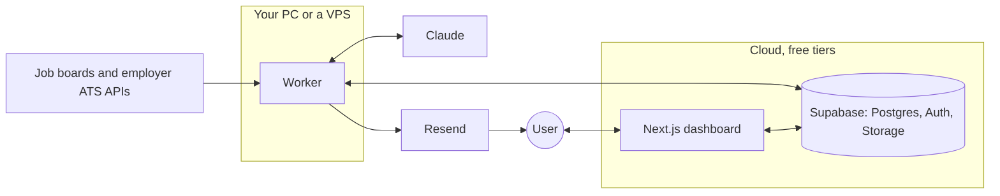

# CV Tailor

An invite-only service that collects job postings every morning, matches them to each user's preferences and delivers them by email and a web dashboard. When a user asks, it writes a tailored CV from that user's own facts. Any occupation, work mode and location: those are per-user data, not assumptions in the code.

## How it fits together



The dashboard, editing and PDF downloads never touch the worker, so they keep working with your PC off. The worker catches up on a missed day when it next starts.

Each morning: `collect -> enrich -> match -> verify live -> email`. When someone clicks for a CV: `tailor -> verify facts -> render`. Collection and enrichment run once per posting and are shared. Only matching and tailoring run per user.

| Path | What |
| --- | --- |
| `packages/core` | Schemas, gates, fact verifier, pre-filter, prompts. No I/O. |
| `packages/llm` | Provider interface: `claude-subscription`, `anthropic-api`, `deepseek`, `fake`. |
| `packages/render` | The one CV and cover-letter PDF template. |
| `apps/worker` | Daily pipeline, source adapters, scheduler. Finds jobs, scores them and sends emails. |
| `apps/web` | Dashboard, onboarding, editor, billing. Writes CVs and reads uploads as people ask. |
| `packages/ai` | AI work both apps run: the budget, CVs on request, onboarding. |
| `supabase/` | Migrations, RLS, local seed. |

## Setup

[`docs/SETUP.md`](docs/SETUP.md) is the full checklist, in levels you can stop at. The short version for local development:

```bash
npm install
npm run db:start                  # needs Docker
cp .env.example .env              # then fill in the keys from: npx supabase status
npm run db:reset
npm run seed
npm test && npm run test:rls && npm run test:integration
npm run web                       # http://127.0.0.1:3000. Magic links land in Mailpit, http://127.0.0.1:54324
npm run worker                    # one pass; add -- --loop to stay up
```

`test:rls` and `test:integration` wipe and rewrite local data, and refuse to run against anything but localhost. Re-run the seeds afterwards.

## Choosing the AI provider

Set by `LLM_PROVIDER`. Pipeline code doesn't know which is active.

| Provider | Needs | Serves | Notes |
| --- | --- | --- | --- |
| `claude-subscription` | `npm run claude:login`, no API key | **You (`OWNER_EMAIL`) and synthetic personas only** | Draws on your Claude plan's limits. Runs one call at a time. Costs in `runs` are estimates. |
| `anthropic-api` | `ANTHROPIC_API_KEY` | Any invited user | Prompt caching, Batch API at half price, refusal fallback. Set a spend limit in the Console. |
| `deepseek` | `DEEPSEEK_API_KEY`, and DeepSeek names in `LLM_MODEL_*` | Any invited user | No Batch API. Prefix caching is automatic. Weekday peak hours cost double, and budgets allow for that. Data goes to DeepSeek, so read [Level 3b](docs/SETUP.md) first. |
| `fake` | Nothing | Tests | Deterministic. |

Why the limit: [Anthropic's terms](https://code.claude.com/docs/en/legal-and-compliance) don't allow routing requests through a Free, Pro, Max or Ultra plan on behalf of other users. In subscription mode, anyone else still gets the code-only filters and a dashboard, with a note saying why they weren't scored.

## Everyday tasks

**Add a user.** Admin page > Who can sign up, or `insert into allowed_emails (email) values ('a@example.com');`. They sign in with a magic link and onboard themselves.

**Run a job by hand.** `npm run worker` makes one pass and is safe to repeat. To re-run a finished day, `delete from daily_runs where run_date = 'YYYY-MM-DD';` first. Stages resume, so nothing already paid for is redone.

**Stop all AI work.** Admin page > Stop all AI work, or `update app_settings set value = 'true' where key = 'kill_switch';`.

**Check quality after changing a prompt.** `npm run eval:enrich`. Replies are cached, so only changed prompts cost anything. Don't tune on the postings marked held out.

**A source is failing.** See [`docs/SOURCE-ISSUES.md`](docs/SOURCE-ISSUES.md).

**Add job sources.** Read [`docs/SOURCES.md`](docs/SOURCES.md). The cheapest start is rows in `companies` with `tags` and `countries`, which needs no code.

## Reading the `runs` table

One row per stage, per user where it's per-user work (`user_id` null means shared).

| Column | Meaning |
| --- | --- |
| `run_date` | The UTC day it belongs to, which budgets are counted against. |
| `stage` | `collect`, `enrich`, `match`, `tailor`, `onboarding`. |
| `status` | `ok`, `failed`, or `skipped`. A failed row's `error` is a category, such as `rate_limit` or `user`. |
| `tokens_in`, `tokens_out`, `calls` | Usage for that stage. |
| `cost_usd` | Estimated cost. Under `claude-subscription` it's notional, nothing is billed per call, but budgets still apply to it, which keeps a run from eating your plan's limits. |
| `provider` | Which provider ran it. |

```sql
-- Spend per day
select run_date, sum(cost_usd), sum(calls) from runs group by 1 order by 1 desc;
-- Cost per user per day
select * from daily_spend where user_id is not null order by run_date desc;
-- What went wrong today
select stage, user_id, error from runs where status = 'failed' and run_date = current_date;
-- Whether today's run finished
select * from daily_runs order by run_date desc limit 7;
```

## Guarantees, and the tests behind them

| Guarantee | Where it's proven |
| --- | --- |
| One user can't see another's data | `apps/worker/test/rls.test.ts`, with two real signed-in users |
| A CV with an invented number, skill or credential is never delivered | `apps/worker/test/tailor.test.ts`, `pipeline.integration.test.ts` |
| Three different personas work end to end, with no special cases | `pipeline.integration.test.ts` |
| A crashed run resumes without paying twice | `pipeline.integration.test.ts` |
| Subscription mode serves only the owner and personas | `pipeline.integration.test.ts`, `packages/llm/src/llm.test.ts` |
| A search no source can serve says so | `sources.test.ts`, `pipeline.integration.test.ts` |
| Webhooks are verified and idempotent | `apps/web/lib/paystack.test.ts` |

## Conventions

See [`CLAUDE.md`](CLAUDE.md) for the rules every change must follow, including how posting text is treated as untrusted and what may never be logged.
